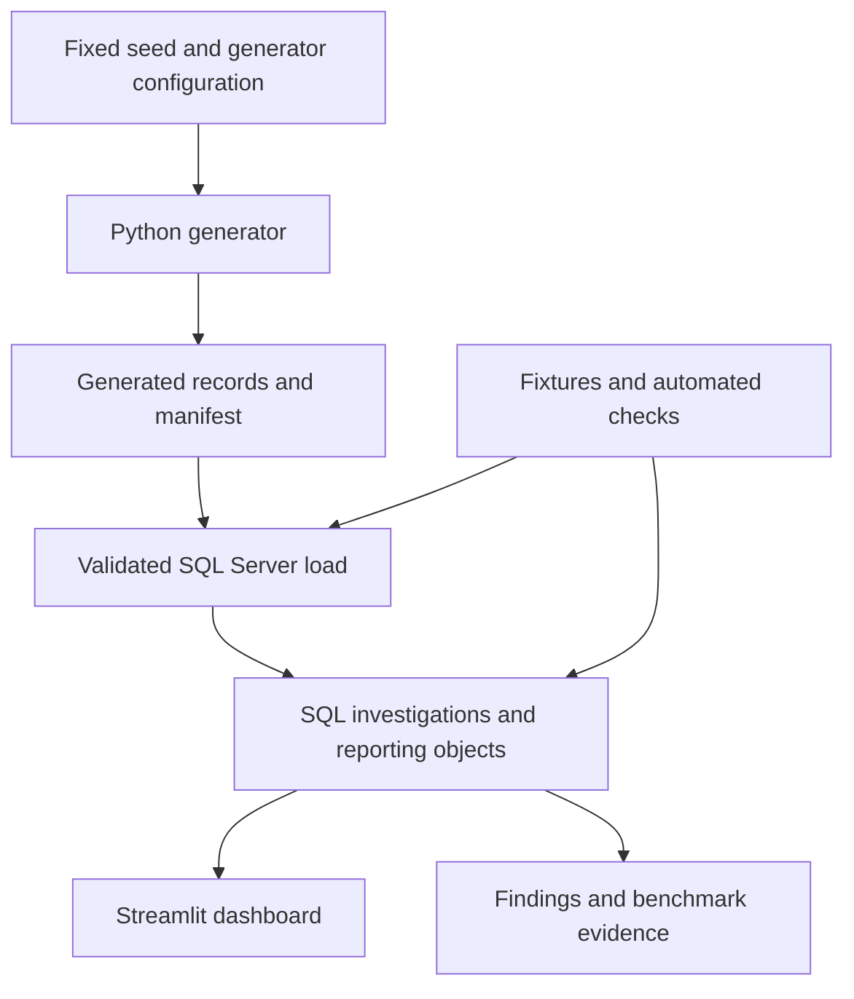

# InnoStaff System Architecture

**Status:** Implementation design baseline.

## Purpose

InnoStaff is a database engineering project with a lightweight reporting application. A Python generator produces fictional records, SQL Server validates and analyzes them, and Streamlit presents SQL results. There are no Domain, Application, and Infrastructure projects, separate API, message broker, or microservices.

The database is the analytical engine. Python is responsible for generation, orchestration, tests, and presentation support. This separation makes the SQL work visible and prevents business calculations from drifting between the dashboard and investigation scripts.

## Data flow

## Component responsibilities

| Component | Owns | Does not own |
|---|---|---|
| Generator | Record relationships, fictional scenarios, deterministic output, manifest | Retention findings or dashboard aggregations |
| Database schema | Data types, keys, constraints, stable historical facts | User accounts or staffing workflows |
| Investigation SQL | Metric definitions, cohorts, temporal joins, segmentation, costs | Rendering charts |
| Reporting views and procedures | Shared dimensions and parameterized SQL results | Python-side analytical reimplementation |
| Streamlit | Navigation, filters, charting, explanatory text | Main retention computations |
| Tests and CI | Known-answer checks and reproducibility verification | Full-size performance certification |

## Database organization and loading

Use one SQL Server database and the dbo schema. Keep database scripts directly in database/ with ordered names. Separate table definitions from reporting procedures and indexes when doing so improves readability; no per-table folder hierarchy is necessary.

Load reference tables before dependent tables. Generate stable integer IDs so cross-references can be checked before ingestion. Where self-references or cycles require it, insert base placement rows with nullable chain references first, then update references in a transaction. Load exit and event records afterward and run cross-table consistency checks before exposing the dataset as ready.

Generation writes ignored local output, and loading targets a new or explicitly reset demonstration database. Loads are not concurrent with dashboard analysis. A failed load must not be described as a ready dataset; setup records success only after all validations pass. Re-running setup must never append a second copy of the same dataset.

## Query and presentation boundary

The reporting layer shares definitions with the seven investigation scripts. A placement-level view provides stable dimensions; dated child observations are selected and aggregated before joining. Procedures accept typed parameters for cutoff, cohort start range, role level, client, site, branch, and retention horizon as applicable.

The dashboard uses a small shared database-access module within dashboard/. It binds parameter values, calls the reporting SQL, and returns rows for charting. Only allowlisted identifiers may be used for selectable SQL grouping; user-supplied strings never become SQL identifiers or executable fragments.

Connection pooling is supplied by the selected database library. If result caching is used, its key includes dataset identity and every query parameter. Reloading data changes the dataset identity or invalidates cached results. No cache is used in SQL benchmark measurements.

## Local runtime and CI

Docker Compose defines a SQL Server service and dashboard service. Initialization and loading may run through a setup script or one-shot service; database readiness must be established before schema application. Pin tested image and dependency versions during environment setup rather than claiming untested compatibility here.

GitHub Actions uses an isolated database and small deterministic records. It exercises schema application, integrity validation, SQL correctness, and generator tests. Full-size query benchmarks run separately on a documented local environment so CI machine variation does not become a misleading performance gate.

Commit an environment example with placeholders. Setup uses an administrative identity only where required; the dashboard uses read-only reporting access. No application login feature is introduced.

## Optional hosted demo

If practical, deploy Streamlit backed by Azure SQL Database with restricted database access. A smaller representative dataset is acceptable when identified in the UI and README. Local full-size results remain the benchmark evidence. Hosting is optional and adds no new analytics features.

## Decisions and tradeoffs

- A normalized relational model exposes join, constraint, historical modeling, and query optimization skills. A separate warehouse or dimensional ETL layer would add unnecessary scope.
- SQL reporting objects keep calculations consistent across scripts and UI. Their query plans remain available for investigation.
- A fixed historical snapshot makes results reproducible. It does not demonstrate live ingestion, concurrent staffing updates, or production availability.
- Streamlit supplies an appropriate presentation surface without duplicating the work of a full frontend project.

See [Database Design](innostaff-database-design-and-data-dictionary.md), [Investigation Plan](innostaff-investigation-plan.md), and [Testing and Performance Plan](innostaff-testing-and-performance-plan.md).
