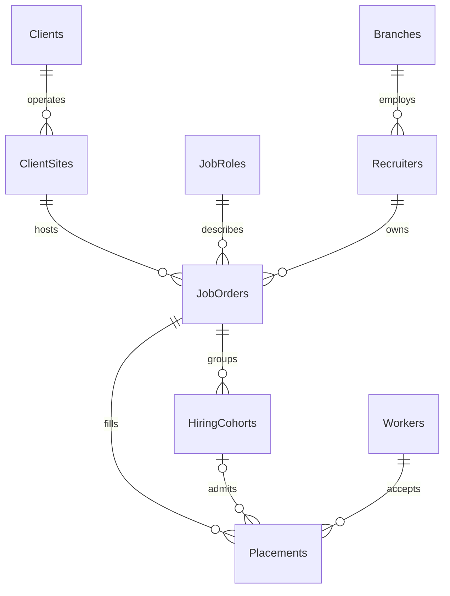
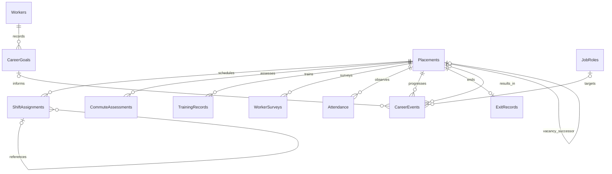

# InnoStaff Database Design and Data Dictionary

**Status:** Implementation design baseline. Schema and validation have not yet been implemented.

## Purpose and conventions

This design supports the seven approved investigations with the original 17 conceptual tables. SQL Server owns integrity and analytical calculations. The model preserves placement history without adding application architecture layers or an operational staffing system.

All tables use the `dbo` schema. Integer surrogate keys are primary keys; they are assigned deterministically during generation. Identifiers are not business measures. All foreign keys use NO ACTION on deletion: demonstration data is reset through an explicit setup operation, not cascading deletion.

Dates are local Bay Area calendar dates. Start dates are inclusive; end dates are exclusive, meaning the first date no longer active. NULL end means no end observed by the dataset cutoff. A placement from January 1 to January 31 is active January 1 through January 30. Timestamps use UTC `datetime2(0)` only where a timestamp is necessary; core analytical records use `date`. A scheduled overnight shift belongs to its starting local date. This project analyzes schedule categories, not daylight-saving-sensitive payroll.

Money is USD with `decimal(12,2)`; rates use `decimal(8,2)`; hours and distances use `decimal(8,2)`; avoid approximate floating point for money. Codes use `varchar`, displayed names and prose use `nvarchar`. N means NOT NULL; Y means nullable. A grouped field entry gives the same type and nullability to every listed field.

## Relationships

Split ERDs keep each view readable. All relationships shown below are implemented as foreign keys; cross-table consistency rules appear later.

The placement self-relationships are `PreviousPlacementId` for the same worker and `ReplacesPlacementId` for a vacancy chain, not necessarily the same worker. CareerEvents optionally references a goal and a resulting placement as well as its required source placement.

## Reference and recruitment tables

### Workers

Grain: one fictional person. Home region and prior work background are baseline profile attributes; later commuting circumstances are captured in assessments.

| Field | Type | Null | Meaning |
|---|---|---|---|
| WorkerId | int | N | PK |
| WorkerCode | varchar(20) | N | Unique fictional reference |
| DisplayName | nvarchar(100) | N | Generated name |
| HomeRegion | nvarchar(60) | N | Baseline region, not street address |
| PriorWorkCategory | varchar(30) | N | Gig, Operations, Technical, Other |
| RegisteredDate | date | N | Agency registration date |

No real names, addresses, birth dates, contact details, or protected demographic attributes are needed.

### CareerGoals

Grain: one dated primary career-goal observation per worker. Goals are append-only; the latest observation on or before an event is used, with CareerGoalId breaking same-date ties.

| Field | Type | Null | Meaning |
|---|---|---|---|
| CareerGoalId | int | N | PK |
| WorkerId | int | N | FK Workers |
| RecordedDate | date | N | When the goal became known |
| GoalFamily | varchar(30) | N | Operations, Software, Network, Systems, IT, Security, StableEmployment, Other |
| GoalDescription | nvarchar(200) | Y | Optional fictional explanation |

### Clients

| Field | Type | Null | Meaning |
|---|---|---|---|
| ClientId | int | N | PK |
| ClientCode | varchar(20) | N | Unique reference |
| ClientName | nvarchar(100) | N | Unique fictional company name |
| IndustrySegment | varchar(40) | N | Fictional technology sector |

### ClientSites

| Field | Type | Null | Meaning |
|---|---|---|---|
| ClientSiteId | int | N | PK |
| ClientId | int | N | FK Clients |
| SiteCode | varchar(20) | N | Unique reference |
| SiteName | nvarchar(100) | N | Fictional site label |
| Region | nvarchar(60) | N | Bay Area region |

### Branches

| Field | Type | Null | Meaning |
|---|---|---|---|
| BranchId | int | N | PK |
| BranchCode | varchar(20) | N | Unique reference |
| BranchName | nvarchar(100) | N | Recruiting branch name |
| Region | nvarchar(60) | N | Branch region |

### Recruiters

| Field | Type | Null | Meaning |
|---|---|---|---|
| RecruiterId | int | N | PK |
| BranchId | int | N | FK Branches |
| RecruiterCode | varchar(20) | N | Unique reference |
| DisplayName | nvarchar(100) | N | Fictional recruiter |

Recruiter-to-branch assignment is fixed in the synthetic history. JobOrders retain their original recruiter; current profile changes must not rewrite historical branch attribution.

### JobRoles

| Field | Type | Null | Meaning |
|---|---|---|---|
| JobRoleId | int | N | PK |
| RoleCode | varchar(30) | N | Unique reference |
| RoleName | nvarchar(100) | N | Displayed title |
| RoleFamily | varchar(30) | N | Same technical families as career goals; no StableEmployment |
| ExperienceLevel | varchar(20) | N | Entry, Intermediate, Experienced |
| RequirementsSummary | nvarchar(500) | N | Fictional entry requirements |

Primary analysis population: ExperienceLevel = Entry and RoleFamily = Operations. Other categories remain available for explicit comparisons.

### JobOrders

Grain: one version of a recruitment opening at one site for one role. Material advertisement changes create a new order, preserving the prior offer.

| Field | Type | Null | Meaning |
|---|---|---|---|
| JobOrderId | int | N | PK |
| JobOrderCode | varchar(20) | N | Unique reference |
| ClientSiteId | int | N | FK ClientSites |
| JobRoleId | int | N | FK JobRoles |
| RecruiterId | int | N | FK Recruiters |
| OpenDate, CloseDate | date | N / Y | CloseDate is exclusive; NULL if still open |
| AdvertisedHourlyWage | decimal(8,2) | N | Positive USD per hour |
| AdvertisedWeeklyHours | decimal(8,2) | N | Positive, at most 84 |
| AdvertisedShift | varchar(15) | N | Day, Swing, Overnight, Rotating |
| AdvertisedWeekendRequired, AdvertisedHolidayRequired | bit | N | Disclosed schedule requirements |
| AdvertisedDuties | nvarchar(1000) | N | Frozen description |
| TransferAvailable | bit | N | Disclosed shift-transfer availability |

### HiringCohorts

Grain: one intake group for a single job order. A job order may have many cohorts.

| Field | Type | Null | Meaning |
|---|---|---|---|
| HiringCohortId | int | N | PK |
| JobOrderId | int | N | FK JobOrders |
| CohortCode | varchar(30) | N | Unique reference |
| CohortStartDate | date | N | Intake date |

Cohort sizes and costs are derived from placements and training, not duplicated here. A placement must reference a cohort belonging to its job order.

## Placement and event tables

### Placements

Grain: one continuous assignment of one worker to one job order. A transfer that changes role or site starts another placement. Internal advancement without reassignment may be a career event.

| Field | Type | Null | Meaning |
|---|---|---|---|
| PlacementId | int | N | PK |
| PlacementCode | varchar(20) | N | Unique reference |
| WorkerId | int | N | FK Workers |
| JobOrderId | int | N | FK JobOrders |
| HiringCohortId | int | Y | FK HiringCohorts; absent for individual starts |
| StartDate | date | N | First active date |
| EndDate | date | Y | First inactive date |
| PlacementStatus | varchar(10) | N | Active or Ended at dataset cutoff |
| HourlyWage | decimal(8,2) | N | Accepted wage, fixed within placement |
| ContractWeeklyHours | decimal(8,2) | N | Agreed hours; not inferred from sampled attendance |
| PreferredShift | varchar(15) | N | Recorded preference at acceptance, including Any |
| HiringPurpose | varchar(15) | N | Growth, Replacement, Transfer |
| ReplacesPlacementId | int | Y | FK Placements; required for Replacement |
| PreviousPlacementId | int | Y | FK Placements; prior assignment of same worker |
| RecruitmentCostUSD | decimal(12,2) | N | Nonnegative recruiting cost, excluding training |

No overlapping placements for the same worker are generated in V1. This is a dataset rule, not a claim that all staffing agencies prohibit overlap. Ended status requires EndDate and exactly one ExitRecords row. Active status requires both absent. Replacements must reference an ended placement at the same site and role; replacement starts on or after its predecessor ends. Growth and Transfer have no ReplacesPlacementId. A unique filtered index on non-NULL ReplacesPlacementId prevents counting multiple immediate successors for the same vacancy.

### ShiftAssignments

Grain: either an effective schedule interval or a dated request to change an existing schedule. Two record types preserve denied requests without adding an eighteenth table or overwriting history.

| Field | Type | Null | Meaning |
|---|---|---|---|
| ShiftAssignmentId | int | N | PK |
| PlacementId | int | N | FK Placements |
| RecordType | varchar(10) | N | Schedule or Request |
| ParentScheduleId | int | Y | Self FK; required for Request |
| EffectiveFrom, EffectiveTo | date | Y | Schedule interval; From required on Schedule |
| ShiftCode | varchar(15) | N | Assigned shift on Schedule, requested shift on Request |
| WeekendRequired, HolidayRequired, ScheduleConsistent, TransferAvailable | bit | Y | Required on Schedule; NULL on Request |
| RequestedDate, ResolvedDate | date | Y | Request timeline |
| RequestStatus | varchar(10) | Y | Pending, Approved, Denied on Request |

Request rows have NULL effective dates and a required RequestedDate. Approved/Denied require ResolvedDate; Pending has no resolution. An approved request becomes a new Schedule row after resolution, closing the old effective interval. The request's parent remains the schedule that prompted the request. Denied requests never change effective schedules. Schedule rows have no request-only values.

### CommuteAssessments

Grain: one dated expectation or experienced commute assessment for a placement.

| Field | Type | Null | Meaning |
|---|---|---|---|
| CommuteAssessmentId | int | N | PK |
| PlacementId | int | N | FK Placements |
| AssessmentDate | date | N | Recorded date |
| AssessmentType | varchar(12) | N | Expected or Experienced |
| HomeRegion | nvarchar(60) | N | Region at assessment |
| OneWayMiles | decimal(8,2) | N | Nonnegative distance |
| OneWayMinutes | smallint | N | Nonnegative duration |
| FuelDailyUSD, TollsDailyUSD, ParkingDailyUSD | decimal(8,2) | N | Nonnegative round-trip workday costs |
| CommuteDaysPerWeek | tinyint | N | Integer 1 through 7 |

Expected assessments precede or equal placement start; experienced assessments occur during the placement. These are synthetic estimates, not GPS or fuel receipts. Unique (PlacementId, AssessmentType, AssessmentDate) prevents ambiguous duplicate observations.

### TrainingRecords

Grain: one training session with one fictional trainer for one placement. Multiple trainers imply multiple session rows.

| Field | Type | Null | Meaning |
|---|---|---|---|
| TrainingRecordId | int | N | PK |
| PlacementId | int | N | FK Placements |
| TrainingDate | date | N | Session date |
| TrainerCode | varchar(20) | N | Synthetic trainer reference; no trainer entity needed |
| TrainingType | varchar(20) | N | Onboarding or Refresher |
| CompletionStatus | varchar(12) | N | Completed, Incomplete, Cancelled |
| DurationHours | decimal(8,2) | N | Nonnegative session duration |
| TrainingCostUSD | decimal(12,2) | N | Nonnegative all-in session cost |
| ConflictingInstructionReported | bit | Y | NULL means unreported |

TrainingCostUSD includes trainer delivery and trainee paid training time; do not add those wages again in business-impact calculations. NULL feedback is not evidence of no conflict.

### WorkerSurveys

Grain: one dated response per placement and date. Scores are worker-reported perceptions.

| Field | Type | Null | Meaning |
|---|---|---|---|
| WorkerSurveyId | int | N | PK |
| PlacementId | int | N | FK Placements |
| SurveyDate | date | N | Response date |
| ExpectationFitScore, TrainingConsistencyScore, ConfidenceScore, JobSatisfactionScore | tinyint | Y | 1 very low through 5 very high |
| ExperiencedDuties | nvarchar(500) | Y | Reported task description |
| StableEmploymentPreferred | bit | Y | Reported preference for stability |

Unique (PlacementId, SurveyDate). At least one response field must be non-NULL. Missing answers remain missing. Surveys stop before the placement's exclusive end.

### Attendance

Grain: one observed scheduled workday per placement. This is a sampled panel of workdays, not a complete payroll ledger.

| Field | Type | Null | Meaning |
|---|---|---|---|
| AttendanceId | int | N | PK |
| PlacementId | int | N | FK Placements |
| WorkDate | date | N | Starting local date |
| ScheduledHours, WorkedHours | decimal(8,2) | N | 0 through 24 |
| AttendanceStatus | varchar(15) | N | Present, Late, ExcusedAbsence, UnexcusedAbsence |

Unique (PlacementId, WorkDate). Absences have WorkedHours = 0. Worked hours cannot exceed scheduled hours in V1, which does not model overtime. Missing rows mean unobserved days, not absence.

### CareerEvents

Grain: one dated advancement or transfer event associated with a placement.

| Field | Type | Null | Meaning |
|---|---|---|---|
| CareerEventId | int | N | PK |
| PlacementId | int | N | FK Placements; source assignment |
| EventDate | date | N | Effective transition date |
| EventType | varchar(20) | N | Promotion, ClientConversion, LateralTransfer |
| TargetRoleId | int | Y | FK JobRoles; unknown target remains NULL |
| CareerGoalId | int | Y | FK CareerGoals; latest known goal before/on event |
| ResultingPlacementId | int | Y | FK Placements; new agency assignment where applicable |

An event can occur on an exclusive EndDate as a transition; same-day conversion explains why that placement ends. No event may occur after it. Conversion does not create a fictional agency placement at the client. Goal alignment is derived from TargetRoleId and the cited goal; missing values yield Unknown, not Misaligned. StableEmployment goals are reported separately rather than forced into a technical role match.

### ExitRecords

Grain: exactly one classification for an ended placement. The exit date is stored once in Placements.EndDate.

| Field | Type | Null | Meaning |
|---|---|---|---|
| ExitRecordId | int | N | PK |
| PlacementId | int | N | Unique FK Placements |
| ExitClass | varchar(20) | N | Voluntary, Involuntary, ContractCompleted, ClientConversion, Transfer |
| PrimaryReason | varchar(30) | N | Commute, Schedule, JobFit, Training, Career, Personal, Performance, ContractEnd, Conversion, Transfer, Unknown |
| AgencyDeparture | bit | N | Explicit agency departure at this transition |
| ExitNotes | nvarchar(500) | Y | Synthetic explanation |

AgencyDeparture is not inferred from a missing subsequent placement. Re-entry after departure is possible. Transfers cannot claim agency departure; conversion leaves agency employment but is reported separately from undesirable turnover.

## Enforcement and historical rules

SQL constraints enforce keys, uniqueness, code domains, numeric ranges, and same-row date consistency. Validation SQL and known-answer tests enforce rules spanning tables: cohort/order agreement; career goal ownership; request-parent placement agreement; no effective schedule overlap; placement/exit consistency; valid replacement chains; and event timing. Ordinary SQL Server CHECK constraints are not used to pretend cross-table conditions are directly enforced.

Every placement has effective schedule coverage from StartDate through its observed end or cutoff. Referenced previous placements belong to the same worker and end before the next starts. CareerGoalId belongs to that worker and cannot point to a future goal. Cycles and self-links in placement chains are invalid. No record is generated beyond the fixed dataset cutoff.

JobOrders, role definitions, recruiter assignments, accepted pay, and baseline profile attributes are fixed within the generated snapshot. This is deliberate scope control, not a universal historical model. Schedule changes and dated observations carry the history needed by this project.

## Indexing and reporting objects

Begin with PK and unique-key indexes plus justified foreign-key access indexes. Candidate indexes cover Placements(JobOrderId, StartDate), Placements(WorkerId, StartDate), and child tables(PlacementId, observation date). Exact includes, filtered indexes, and index order are selected from real plans in the three case studies; these are hypotheses, not measured recommendations.

Reporting views expose one-row-per-placement dimensions and correctly aggregated child facts. Parameterized procedures calculate retention and filtered reports. Views do not accept parameters; procedures receive cutoff, start range, threshold, and segment filters. Never join all raw one-to-many tables before aggregating: it would multiply observations.

Metric formulas and event-time selection are authoritative in [Investigation Plan](innostaff-investigation-plan.md). Setup and test sequencing are in [Development and Delivery Plan](innostaff-development-and-delivery-plan.md).

## Implementation review gate

Before writing schema SQL, walk through one example worker with two placements, one denied request, one later schedule change, an experienced commute assessment, and a conversion. Confirm each record has a clear location and each investigation has its required fields. This design is ready for that review; no database objects or test outcomes are claimed here.
